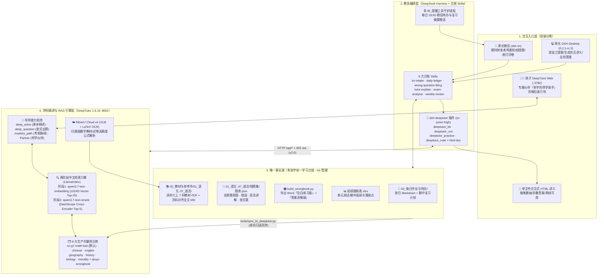
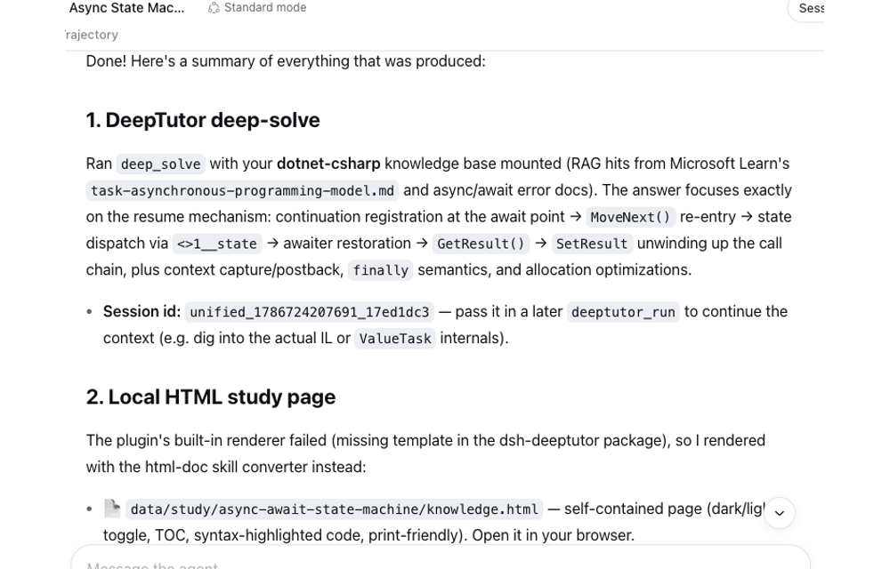
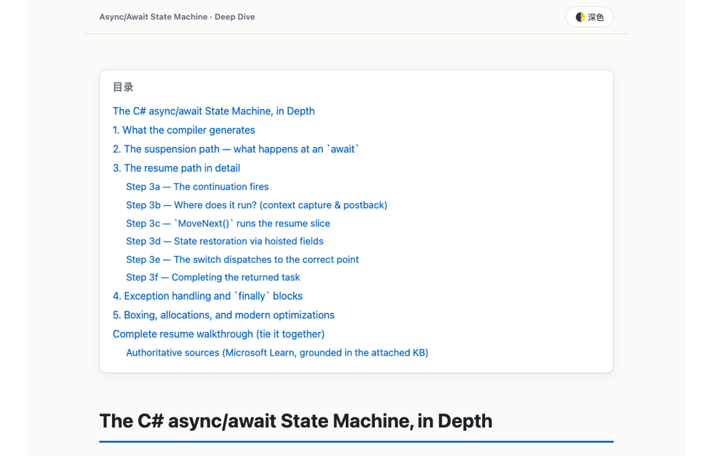

<!-- SZ-JUNIOR-HIGH-CUSTOM-README -->
# 深圳初一智能伴学与学习台账系统 · 架构与使用指南

> **适用对象**：朱秋宇（深圳石厦中学 · 七年级）及家长  
> **运行底座**：Mac Mini (Apple Silicon) 本地常驻服务 + 阿里云百炼 (DashScope) + MinerU Cloud v4  
> **核心仓库**（均基于 `sz-junior-high` 定制分支）：
> - 学科引擎：[DeepTutor](https://github.com/sambazhu/deeptutor-shenzhen-junior-high/tree/sz-junior-high)（`:8001` API / `:3782` Web）
> - 桥接插件：[dsh-deeptutor](https://github.com/sambazhu/dsh-deeptutor-shenzhen-junior-high/tree/sz-junior-high)（挂载于 DeepSeek Harness `0.2.1-rc.3`）
> - 事实源台账：`朱秋宇初一学习台账`（本地私有 Git 仓库）

---

## 一、 为什么要做这套系统？（痛点与设计哲学）

通用的 AI 聊天机器人在辅导初中孩子时有三个致命短板：
1. **“无书可依、容易超纲”**：通用大模型不知道深圳初一数学用的是**北师大版**、英语用的是**沪教牛津版**，讲题时经常用初二/初三的“二元一次方程组、一次函数、相似三角形”去解初一上册的题，孩子听不懂也没法写进卷子。
2. **“一问就给答案，沦为抄作业工具”**：孩子把作业题拍上去，通用 AI 直接甩出完整过程和最终答案，起不到启发思考的作用。
3. **“对话即焚，没有长期台账”**：每天的学校作业通知、错题订正、期中复习进度、D+1/3/7/15 艾宾浩斯复习记录散落在聊天记录里，无法沉淀成可打印的错题卷和成绩跟踪表。

为此，本系统采用 **“本地结构化台账（唯一事实源） + DSH 教务总管（家长端） + DeepTutor 课本精讲引擎（孩子端）”** 的三层解耦架构：

> [!IMPORTANT]
> **五大核心设计原则**
> 1. **台账是唯一事实源（SSOT）**：所有每日作业、错题题库（`题库.json`）、考试成绩（`成绩跟踪表.xlsx`）只写进本地 Git 版本控制的台账目录，不在外部系统另存第二份错题本。
> 2. **DeepTutor 是带课本依据的教研引擎**：内置深圳七年级上册全套 **7 科官方教材全文知识库** + **秋宇个人错题库**，专门负责“翻课本原话、双法讲题、出同类变式题、做交互式讲义”。
> 3. **数据单向流动**：`台账 ──(sync_to_deeptutor.py 只读导出)──▶ DeepTutor 知识库`；DeepTutor 产出的讲解与变式题必须打上 `explanation_source: "deeptutor"` 与 `verified: false` 标签，由 DSH 按台账规范写回。
> 4. **家长与孩子双端物理隔离**：家长用 **微信 (`dsh-im`) / DSH Desktop** 管台账、出打印卷；孩子用 **DeepTutor Web (`:3782`) 伙伴** 或 **单文件交互 HTML** 伴学，孩子端无权修改台账文件与标准答案。
> 5. **反幻觉质量门禁**：数学题强制要求**两种独立方法交叉验算**（如代数推导 + 特殊值代入/几何核对）；未经人工或第二种方法确认的内容在 Word 错题卷上自动印上 `❓待核对` 徽章。

---

## 二、 整体系统架构图



---

## 三、 角色分工：家长用什么？孩子用什么？

### 1. 家长端（微信 `dsh-im` + DSH Desktop）——“教务总管 + 错题印刷厂”

家长平时**完全不需要打开 DeepTutor 后台**，所有操作都在手机微信或桌面端 DSH 完成：

| 高频场景 | 家长怎么操作 | 系统在后台做了什么 | 最终产出物 |
|---|---|---|---|
| **① 记每日作业与学校通知** | 在微信把班级群通知、作业截图转发给 DSH 助手 | `im-intake` 防割裂缓冲合并 → `daily-ledger` 解析各科作业、交表截止时间与期中复习项 | 更新当日 `00_每日作业与待办/YYYY-MM/YYYY-MM-DD_周X.md` |
| **② 每日 18:00 晚间提醒** | 自动触发（无需操作） | `09_提醒工具` 读取当日台账与《期中复习计划》，汇总未完成项推送到微信 | 每天 18:00 收到微信今日待办与复习摘要 |
| **③ 录错题 + 抠原题图** | 微信拍孩子的错题照片或发试卷 PDF，说“第20题记入数学错题” | `wrong-question-filing` 自动裁剪数轴/几何原题图（去除红蓝批注），写入 `02_数学/错题集/题库.json` | 原题图存入 `错题集/原图/`，题目录入 `题库.json` |
| **④ 课本对齐精讲 + 出同类变式** | 对 DSH 说：“用 `deeptutor_practice` 给第19题补北师大教材讲解和2道变式” | `dsh-deeptutor` 只读提取错题 → 挂载 `sz-g7-math-bsd` + `qiuyu-wrongbook` → 生成带课本页码的双法验证解析与 2 道变式题 → 写回 `题库.json` 并运行 `tools/build_wrongbook.py` | 自动生成两份排版精美的 Word：<br/>1. `数学_错题练习_空白版.docx`（打印给孩子重做）<br/>2. `数学_错题练习_参考答案与讲解.docx`（含变式题与 `❓待核对` 标记） |
| **⑤ 生成专题交互式讲义** | 对 DSH 说：“用 `deeptutor_run` 结合北师大教材讲透数轴两点距离，生成 HTML” | 调用 DeepTutor `deep_solve` 检索 P29/P34/P37/P48 教材原话与孩子历史错题 → `html-doc` 渲染单文件交互网页并通过微信发回 | 单文件 `.html`（带可拖拽 SVG 数轴、折叠答案、深浅色切换，手机/iPad 点开即用） |

---

### 2. 孩子端（DeepTutor Web `:3782` + 打印版 Word + 交互 HTML）——“苏格拉底式家庭教师”

孩子の使用界面极简、安全，且与台账写入权限物理隔离：

1. **日常做题卡壳 / 课本伴读 —— 用浏览器打开 `http://127.0.0.1:3782`「伙伴（Partner）」**：
   - 选择专属伙伴 **「秋宇的深圳初一伴学助手」**（已配置专属 `Soul` 与 8 个知识库）。
   - **三阶防抄袭边界**：当秋宇问一道当天作业题时，伴学助手遵循 **“小提示（点出课本章节与考点）→ 进一阶提示（列出第一步方向或等量关系）→ 孩子尝试后再给完整步骤”**，绝不一上来给最终答案。
   - **纯正深圳教材口径**：所有概念、例题均检索自深圳初一 7 科课本库，绝不用超纲方法。
2. **薄弱专题突破 —— 打开家长发来的单文件 `.html` 交互讲义**：
   - 离线可用，包含课本原话、推导链条、可动手拖拽的图形交互区（如拖动数轴上 $A, B$ 两点实时观察 $|a-b|$ 与中点变化），自测题答案默认折叠。
3. **周末/考前刷错题 —— 做家长打印的 `空白版.docx`**：
   - 包含原题（带扣好的数轴/几何干净原图）+ DeepTutor 针对该题生成的同类变式题，预留充足手写答题空行。

---

## 四、 核心技术实现细节（供技术人员参考）

### 1. 深圳七年级 8 大向量知识库体系

所有七年级上册教材均已按页提取并注入页码与章节树锚点（格式：`### 【学科七上 · PDF第X页 · 章 / 节】`），由 `tools/sync_to_deeptutor.py` 统一构建为 LlamaIndex 向量库：

| 知识库 ID | 学科与深圳教材版本 | 文档解析方式 | 切片规模 |
|---|---|---|---|
| `sz-g7-math-bsd` *(默认)* | **数学 · 北师大版七上**（209页扫描版） | **MinerU Cloud v4 (`vlm`)** 自动分片 OCR + LaTeX 公式提取 + 42条书签页码对齐 | 354 chunks |
| `sz-g7-chinese-tb` | **语文 · 统编版七上**（166页） | PyMuPDF 矢量文字逐页提取 + 63条目录页码对齐 | 359 chunks |
| `sz-g7-history-tb` | **历史 · 统编版七上**（134页） | PyMuPDF 矢量文字逐页提取 + 25条目录页码对齐 | 266 chunks |
| `sz-g7-biology-rj` | **生物 · 人教版七上**（146页） | PyMuPDF 矢量文字逐页提取 + 34条目录页码对齐 | 263 chunks |
| `sz-g7-english-hj` | **英语 · 沪教牛津版七上**（169页） | PyMuPDF 矢量文字逐页提取 + 32条目录页码对齐 | 212 chunks |
| `sz-g7-geography-xj` | **地理 · 湘教版七上**（136页） | PyMuPDF 矢量文字逐页提取 + 28条目录页码对齐 | 194 chunks |
| `sz-g7-morality-tb` | **道法 · 统编版七上**（114页） | PyMuPDF 矢量文字逐页提取 + 47条目录页码对齐 | 158 chunks |
| `qiuyu-wrongbook` | **全科错题库**（只读同步自台账 `题库.json`） | `sync_to_deeptutor.py --wrongbook` 自动导出单题 Markdown | 随错题增长 |

### 2. 中文教材两阶段 RAG 检索调优（Vector + DashScope Rerank）

在实测中我们发现：LlamaIndex 默认的 `hybrid` 模式内置的 `BM25Retriever` 采用英文空格/词干分词器（`bm25s`），面对中文无空格短语（如“有理数加法法则”）时无法切词，只会随机召回含数字/表格的噪声块，并通过 RRF（$\frac{1}{60+\text{rank}}$）拉低有效分值；而纯向量检索（`vector`）虽对自然语言极准，却对“例2 加法交换律”这类含编号的短查询不够敏感。

**定制解决方案**（见 [rerank.py](https://github.com/sambazhu/deeptutor-shenzhen-junior-high/blob/sz-junior-high/deeptutor/services/rag/pipelines/llamaindex/rerank.py) 与 `~/.deeptutor/data/user/settings/llamaindex.json`）：
1. **第一阶段（高召回）**：关闭英文 BM25，使用阿里云百炼 `qwen3.7-text-embedding`（1024 维）纯向量检索召回 Top 25 候选切片（`rerank_top_k: 25`）；
2. **第二阶段（精排）**：在 DeepTutor 内部接入百炼 HTTP 重排接口（`POST https://dashscope.aliyuncs.com/compatible-api/v1/reranks`），使用 **`qwen3.7-text-rerank`** 对 25 个候选切片做交叉注意力重排并截取 Top 5（`top_k: 5`）。
3. **实测效果**：无论是搜概念（`"有理数加法法则"` → P42 法则原文以 `0.9933` 排第 1），还是搜编号短词（`"例2 加法交换律"` → P44 例2 原题以 `0.8022` 排第 1），均无需人工改写查询即可一击命中。

### 3. `dsh-deeptutor` 插件面向 DeepTutor 1.6.15 与深圳初一的改造

在 [dsh-deeptutor](https://github.com/sambazhu/dsh-deeptutor-shenzhen-junior-high/tree/sz-junior-high)（`sz-junior-high` 分支）中完成了以下核心改造（48/48 单元测试全绿）：
- **协议升级**：全面适配 DeepTutor `1.6.15` 新版 REST 与 WebSocket v2.0 协议（`/api/system/status`、`/ws` `protocol_version: "2.0"`、`/api/knowledge-bases`、`/api/notebooks`），同时保留 `1.5.x` 向下兼容。
- **新增第 4 个工具 `deeptutor_practice`**（见 [ledger.ts](https://github.com/sambazhu/dsh-deeptutor-shenzhen-junior-high/blob/sz-junior-high/src/ledger.ts) / [index.ts](https://github.com/sambazhu/dsh-deeptutor-shenzhen-junior-high/blob/sz-junior-high/src/index.ts)）：传入台账错题 ID（如 `MATH-20261016-19`），自动只读定位对应学科 `题库.json`，挂载对应学科教材库与 `qiuyu-wrongbook`，完成双法验证精讲与变式题生成，并输出可直接合入 `题库.json` 的标准补丁。
- **`subject` 自动路由与 `child_mode` 安全护栏**（见 [config.ts](https://github.com/sambazhu/dsh-deeptutor-shenzhen-junior-high/blob/sz-junior-high/src/config.ts)）：传入 `subject="数学" | "语文" | "英语" | "地理" | "历史" | "生物" | "道法"` 自动挂载对应教材库 + 错题库；开启 `child_mode` 时在底层 Prompt 强制注入苏格拉底防代写护栏。

---

## 五、 常用维护命令速查

```bash
# 1. 台账新增或修改错题后，重新生成 Word 空白卷+解析卷，并同步到 DeepTutor 错题库
cd /Users/sambazhu/dshworkplace/朱秋宇初一学习台账
/Users/sambazhu/.deeptutor-venv/bin/python tools/build_wrongbook.py 数学
/Users/sambazhu/.deeptutor-venv/bin/python tools/sync_to_deeptutor.py --wrongbook

# 2. 检查 DeepTutor 常驻服务状态与 8 个知识库状态
curl -s http://127.0.0.1:8001/api/system/status
DEEPTUTOR_HOME=/Users/sambazhu/.deeptutor /Users/sambazhu/.deeptutor-venv/bin/deeptutor kb list

# 3. 平滑重启 DeepTutor 后台服务（launchd 开机自启）
lsof -ti :3782 | xargs kill -9 2>/dev/null || true
launchctl kickstart -k gui/$(id -u)/com.hkuds.deeptutor

# 4. 修改 dsh-deeptutor 插件源码后重新编译并安装到 DSH Desktop
cd /Users/sambazhu/dshworkplace/dsh-deeptutor
npm run typecheck && npm test && npm run build
node scripts/install-profile.mjs --profile desktop --local
```

---

<details>
<summary><b>📖 点击展开：上游原版说明文档 (Original Upstream README)</b></summary>

# dsh-deeptutor

**English** | [简体中文](https://github.com/TecFancy/dsh-deeptutor/blob/main/README.zh.md)

A **learning-assistant extension for DeepSeek Harness (dsh)**. It connects your
agent to a [HKUDS/DeepTutor](https://github.com/HKUDS/DeepTutor) tutoring
service, so a dsh session can explain topics in depth, quiz you, plan learning
paths, search your personal knowledge bases, and keep a study notebook — all
without leaving the harness.

Ask the agent *"teach me async/await"* and it can run a deep-solve, render the
answer as a self-contained HTML study page you can open in a browser, and
archive a summary into your notebook.

Migrated from the pi coding-agent extension
(`TecFancy/pi-extensions`, `extensions/deeptutor` + `skills/deeptutor`).

## What it adds

Three agent-facing tools that the model uses whenever you ask for learning help:

| Tool | What it does |
|---|---|
| `deeptutor_run` | Runs one learning capability: `deep_solve` (in-depth explanation), `deep_question` (self-test questions), `deep_research`, `chat`, `mastery_path` (learning-path planning), `visualize` / `math_animator` (visualization). Can mount your knowledge bases (`kbs`) and tools (`rag`, `web_search`, `reason`, `code_execution`, …); returns a `session_id` so later turns continue the same context. |
| `deeptutor_kb` | Lists, searches, and inspects your personal knowledge bases (RAG) |
| `deeptutor_note` | Archives Markdown study notes (plans, summaries, wrong answers) into a server notebook |

The seven capabilities above are the fixed enum accepted by `deeptutor_run`.
The underlying DeepTutor CLI may expose more — enumerate the full command set
with `deeptutor --help` / `deeptutor <cmd> --help`. The `deeptutor` skill
instructs the agent to discover commands this way and, when the tool's enum
doesn't cover a capability, to drive the CLI directly (local binary or over
SSH).

## Example session

A typical flow when you ask your agent for learning help:

1. **Ask** — *"Explain C# generics covariance using my dotnet knowledge base, and generate a study page."*
2. The agent grounds the answer in your own material: `deeptutor_kb` (`action=search`, `kb=dotnet`).
3. It runs a deep-solve: `deeptutor_run` (`capability=deep_solve`, `kbs=[dotnet]`, `html=data/study/csharp-covariance.html`) — the answer comes back and a self-contained HTML page (plus the `.md` source) is written to disk.
4. It files a summary: `deeptutor_note` (`notebook=dotnet-learning`, `type=solve`).

Nothing here is a fixed script — the agent picks the tools and parameters based
on what you ask for.

A real recording of exactly this flow (deep-solve on the async/await state
machine, mounted on a `dotnet-csharp` knowledge base, rendered to an HTML
study page, then archived to a notebook):





## Requirements

- A working DeepSeek Harness (dsh) install, 0.1.0-rc.6 or newer. The manifest
  declares a version floor rather than a ceiling, so a new dsh release is never
  refused at install time; a scheduled probe boots the plugin against the
  current npm `latest` and `next` hosts instead and opens an issue when
  activation breaks. Bundle auto-registration via `dsh plugin add` was verified
  on dsh CLI 0.1.0-rc.6, 0.2.1-rc.2 and 0.2.1-rc.3.
- A DeepTutor deployment, either:
  - **Local** — `deeptutor serve` running on this machine, or the `deeptutor`
    CLI on `PATH` (used as fallback);
  - **Remote** — DeepTutor on a server, reached through an auto-started SSH
    tunnel (with SSH CLI fallback).

## Install into a profile (bundle)

The package is published to npm as `dsh-deeptutor`. Recommended one-liner —
runs the bundled installer (`scripts/install-profile.mjs`, exposed as the
`dsh-deeptutor` binary), which wraps `dsh plugin add` and automatically
handles the pnpm workspace-root check described below:

```sh
pnpm dlx dsh-deeptutor --profile web
```

From a checkout of this repo, the same installer runs directly:

```sh
node scripts/install-profile.mjs --profile web
```

Or run the underlying command yourself — `dsh plugin add` forwards to pnpm
and then reconciles the profile's `dsh.profile.bundles` against the installed
state, so a `dsh.bundle`-declaring package like this one is registered
automatically:

```sh
dsh plugin --profile web add dsh-deeptutor -w
```

> **Pitfall — pnpm workspace-root check.** The dsh profile scaffold always
> writes a `pnpm-workspace.yaml` (`packages: ["."]`, `nodeLinker: hoisted`),
> which makes the profile directory itself a pnpm workspace root. On
> pnpm ≥ 8, `pnpm add` in a workspace root aborts with
> `ERR_PNPM_ADDING_TO_ROOT` unless the workspace-root flag is explicit, so
> the command above appends `-w`/`--workspace-root` (pnpm prints this error
> on stdout on Windows, which is why a plain `dsh plugin add` without the
> flag fails even though the output looks like a warning). Two ways to
> handle it:
>
> 1. Use the installer / keep `-w` in the command (recommended — the
>    installer tries the plain command first and adds `-w` automatically
>    only when the check trips).
> 2. Or allow the plain command permanently: add
>    `ignore-workspace-root-check: true` to
>    `~/.dsh/profiles/<name>/pnpm-workspace.yaml`, then
>    `dsh plugin --profile web add dsh-deeptutor` works as written.

Verify the bundle is mounted, then restart dsh (the bundle list is resolved
at boot):

```sh
dsh --profile web --dump-config | grep dsh-deeptutor
```

If your dsh CLI does not auto-register the bundle (older versions, or you
installed the dependency manually), add it to the profile manifest
(`~/.dsh/profiles/<name>/package.json`) and run `dsh plugin --profile web
install`:

```json
{
  "dependencies": { "dsh-deeptutor": "^0.1.0" },
  "dsh": {
    "profile": { "bundles": ["@deepseek-ai/dsh-base", "@deepseek-ai/dsh-web-app", "dsh-deeptutor"] }
  }
}
```

Alternatively, keep the manifest untouched and mount the bundle through a user
patch layer (the npm package still has to be installed first):

```yaml
# overlay.yml — insert the bundle row via a user patch layer
- insert:
    - id: dsh-deeptutor
      name: 'dsh-deeptutor'
```

```sh
dsh web --patch ./overlay.yml
```

The bundle manifest (`dsh.bundle.patch → cordis.patch.yml`) inserts the plugin
row; later patch layers can override or disable it by id.

## Skills

Two skills ship inside this package (`.agents/skills/deeptutor` and
`.agents/skills/html-doc`) and the bundled installer copies them to
`<DSH_HOME>/skills/<name>/` (auto-discovered by dsh) whenever it runs — so
`pnpm dlx dsh-deeptutor` installs the bundle **and** the skills in one shot:

- `deeptutor` — the agent-facing learning workflow (`~/.dsh/skills/deeptutor/SKILL.md`)
- `html-doc` — renders study answers to self-contained HTML pages
  (`~/.dsh/skills/html-doc/`); the bundle uses the same converter
  (`scripts/md-to-html.js`) when `deeptutor_run` gets an `html` path

Installing a newer package version overwrites skill files in place; files not
shipped by the package are never deleted.

The files under `.agents/skills/` are byte-identical copies of the same
skills in `TecFancy/pi-extensions` (single source of truth, agent-neutral).
Sync them after upstream edits with
`node scripts/sync-skills.mjs ../pi-extensions`.

## Configuration (env vars, agent-agnostic)

```bash
# Remote deployment (DeepTutor on a server, reached through an SSH tunnel)
export DEEPTUTOR_SSH_HOST="tencent-cloud"           # SSH host alias (set = remote mode)
export DEEPTUTOR_API_BASE="http://127.0.0.1:8001"   # local tunnel address
export DEEPTUTOR_REMOTE_BIN="/home/ubuntu/my-deeptutor/.venv/bin/deeptutor"
export DEEPTUTOR_REMOTE_HOME="/home/ubuntu/my-deeptutor"

# Local deployment — leave DEEPTUTOR_SSH_HOST unset
# export DEEPTUTOR_API_BASE="http://127.0.0.1:8001"  # local serve port
# export DEEPTUTOR_LOCAL_BIN="deeptutor"             # local CLI path (default: deeptutor on PATH)
```

Restart dsh after changing env vars.

## How it works

The plugin auto-detects the deployment: if a DeepTutor API is reachable (local
`serve`, or a remote server via tunnel), learning turns run over HTTP/WebSocket;
otherwise it falls back to the CLI — the local `deeptutor` binary, or the remote
binary over SSH. Remote mode starts the SSH tunnel on demand and tears it down
when the plugin unloads.

## Develop against a checkout (no publish needed)

```sh
dsh web --patch /path/to/dsh-deeptutor/cordis.yml
```

## Build & publish

```sh
npm install
npm run build        # tsc → lib/ (relative .ts imports rewritten to .js)
npm run typecheck
npm test             # node:test + type stripping
npm pack             # inspect dsh-deeptutor-<version>.tgz
npm publish          # set a scope/registry of your choice first
```

Node ≥ 22.6 (type stripping) is needed to load the raw `src/*.ts` via
`--patch`; the published bundle ships compiled `lib/`, so installed profiles
run on plain Node ≥ 20 ESM.

## Layout

```
src/                 # TypeScript sources (dev loading, typecheck)
lib/                 # compiled ESM (published entry, from `npm run build`)
scripts/md-to-html.js  # zero-dependency Markdown → HTML converter
scripts/install-profile.mjs  # one-shot profile installer (exposed as the `dsh-deeptutor` binary)
.agents/skills/       # bundled skills: deeptutor/ + html-doc/ (installed to <DSH_HOME>/skills/)
cordis.yml           # dev overlay: insert src/index.ts by absolute path
cordis.patch.yml     # bundle patch: insert the package by name
```

`src/index.ts` registers the tools; `config.ts` holds env config;
`cli-exec.ts` local/SSH CLI execution; `http-api.ts` API probing + SSH tunnel;
`turn.ts` one learning turn (WebSocket / CLI event folding + formatting);
`html-render.ts` answer → self-contained HTML.

</details>
<!-- END-SZ-JUNIOR-HIGH-CUSTOM-README -->
